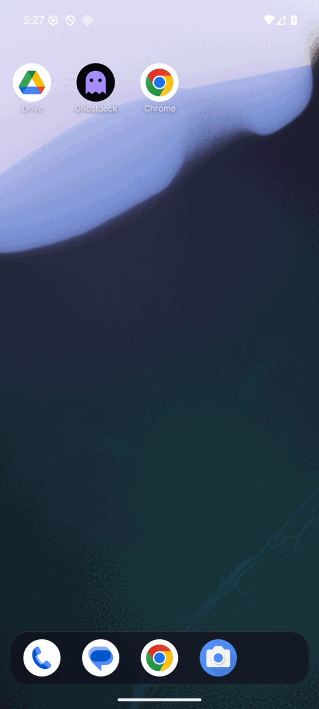
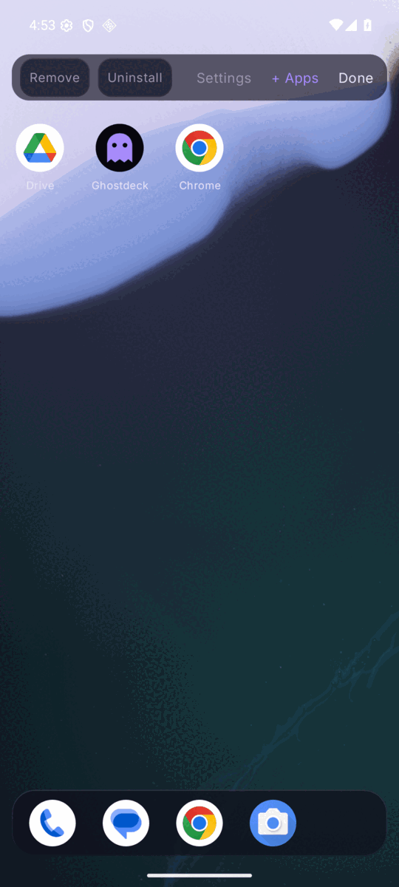

# 👻 Ghostdeck

**A privacy-first Android launcher that rearranges itself for where you are, works as a power tool, and never phones home.**

> 🚧 **Status: M1 (home core) working.** Ghostdeck runs as a real home screen: paged grid with half-cell placement, dock, folders, edit mode, theme packs, onboarding, settings and opt-in badges, all run on an emulator. Icon packs and Private Space (and Work profile apps): implemented, unverified on a physical device. Decks, search, widgets and the Command Bar come in later milestones, and there's no release APK yet.

| Home | Edit mode |
|---|---|
|  |  |

## 🔧 Build and install

Needs JDK 17 and the Android SDK (platform 36, build-tools 36.0.0).

```bash
export ANDROID_HOME=~/android        # your SDK path
./gradlew installDebug               # installs net.cybercoretech.ghostdeck.debug on the connected device
```

Then press Home and choose **Ghostdeck**, or accept "Set as home" in the first-run screen. The first run shows the Privacy Charter and asks for no permissions.

Checks: `./gradlew testDebugUnitTest lint assembleRelease`, then `tools/privacy-gate.sh` (see [PRIVACY.md](PRIVACY.md)). The emulator smoke test is `./gradlew connectedDebugAndroidTest` on a device with animations off (`adb shell settings put global animator_duration_scale 0`).

---

## 🃏 What makes it different

| | Feature | In short |
|---|---|---|
| 🃏 | **Context Decks** | Separate workspaces (Work, Car, Night, Gaming…), each with its own layout, dock, widgets and look. They switch automatically by time, Wi‑Fi, Bluetooth, charging or headphones, and always tell you *why* |
| 🔮 | **Intelligent search** | On-device intent search: typos, synonyms (`pay` finds wallet apps), natural-language actions (`text mom I'm late`), context-aware ranking, and "Why this?" on every result |
| 🧩 | **Universal widgets** | Android widgets, Ghostdeck tiles and plugin tiles share one grid, with **smart stacks** that bring the right widget to the top |
| 🎯 | **Radial command menu** | Long-press anywhere and flick toward an action, without waiting for the menu to appear |
| 🗂️ | **Smart Groups** | Apps grouped automatically by purpose, usage and your own rules. Your overrides always win |
| ⚡ | **Power-user layer** | Remappable gestures, drawn glyphs, aliases and macros, hardware keyboard, Tasker/`adb` API, and a config file |
| 🌗 | **Adaptive interface** | Per-deck appearance profiles that follow accessibility settings, dusk and context |
| 🤖 | **Agents** | `@claude`, `@gpt`, `@gemini`, `@copilot` from the command bar. Handoff to installed apps needs no network. Optional on-device AI (Mind) and bring-your-own-key cloud AI (Link plugin). Consent chips show exactly what's sent, and agents only *propose* actions |
| 🔌 | **Plugins** | Commands and tiles from other apps (Nightwatch first). Any network access lives in the plugin, never in Ghostdeck |

## 🛡️ Privacy Charter

1. **No advertisements.** Ever, in any build.
2. **No behavioural tracking.** Ghostdeck learns from your use **only on your device**, for you, and shows you everything it has learned (11a.3).
3. **No selling or sharing of data.** There is no server to send it to.
4. **Local-first.** All settings, layouts and learned signals live on the device. Export them yourself if you want them anywhere else.
5. **Optional AI, on-device by default.** Cloud AI only through the separate Link plugin, with your own keys, and nothing is sent without you seeing exactly what.
6. **Transparent permissions.** Every permission is requested at the moment it's needed, with a plain-language reason, and listed in the Privacy Ledger.
7. **No account.** Nothing to sign up for, ever.

**Enforced, not just promised:** the core APK has **no `INTERNET` permission**, and CI fails the build if one ever appears, or if tracker code or tracker libraries show up. Builds will be reproducible and published on F-Droid. Details and how to check it yourself: [PRIVACY.md](PRIVACY.md).

## 🎨 Design

**Phantom Glass** home (frosted dark glass, soft glow), a **Terminal Ghost** command bar and agent panels (monospace, streaming), and **Void** widgets that only appear when relevant. Theme packs come from the Cybercore theme registry. Signature motion: phase shift, materialize, ghost trail, terminal stream, consent glow, haunt.

## 🧱 Architecture

```
L3  Interaction   gestures · radial · command bar · keyboard · automation · plugins
L2  Intelligence  context · deck resolver · search ranking · Smart Groups · adaptation
L1  Visual        decks · grid · icons · widgets/tiles · themes · animation
```
L1 draws, L2 decides (and records why), L3 turns input into one shared set of actions.

## 📐 Design docs

- 📄 [MVP design spec](docs/superpowers/specs/2026-11-07-ghostdeck-mvp-design.md)
- 🗺️ [M0 + M1 build plan](docs/superpowers/plans/2026-11-07-ghostdeck-m0-m1-foundation.md)
- 🛡️ [Privacy](PRIVACY.md)

## 🛠️ Stack

Kotlin · Jetpack Compose · Material 3 · kotlinx-serialization (one JSON config) · minSdk 30 / targetSdk 36 · no Google Play Services

## 📜 License

[GPL-3.0-or-later](LICENSE). Ghostdeck stays free and open, and so do its forks.

---

👻 Code & Design by Darkstardevx 🤖 Generated with Claude Code
